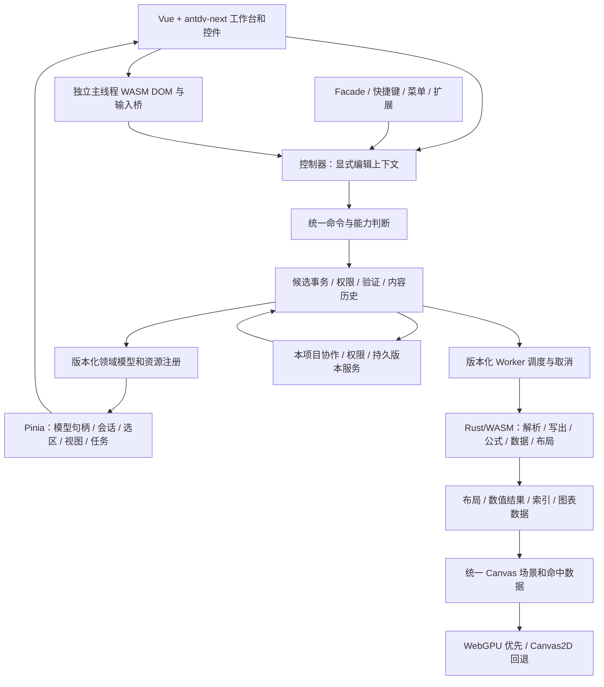

# Office Viewer 项目执行标准

## 1. 项目目标

本项目是一个运行在浏览器中的 Office 工作台，使用 Vue 3 + TypeScript + Vite 构建界面，使用 Rust/WASM 承担 Office 文件解析、重计算和独立浏览器平台适配，使用 `duke-pages` 和 `rxls` 作为当前解析引擎，使用 `antdv-next` 构建企业级 UI。

产品目标是对齐 Univer 的 Sheets 与 Docs 功能、页面布局、交互和公开 API，包括这两个产品的所有 Pro 功能。固定参考仓库 `E:\rust_test\univer` 中值得采用的设计都可以借鉴，按本项目技术栈改写并验证优化；无公开源码的能力按公开规格和可观察行为独立实现。不得将目标自行缩减为“核心能力”“基础版”或解析演示。

本标准及以下文件共同构成执行规则，适用于主任务和所有子任务：

- [Univer 源码、布局与分层规则](docs/UNIVER_REFERENCE_RULES.md)：固定源码版本、具体参考文件、布局顺序和架构约束。
- [完整功能与 Pro 对齐清单](docs/UNIVER_FEATURE_PARITY.md)：功能编号、公开依据、交付要求和验收状态。
- [Canvas/WebGPU 与 WASM 计算标准](docs/RENDERING_AND_COMPUTE_STANDARD.md)：Canvas 编辑器、WebGPU 优先后端、Worker/WASM 大计算、内存与性能验收。
- [AGENTS.md](AGENTS.md)：进入本项目工作的执行入口。
- [完整工作台架构](#workbench-architecture)：全部 65 个功能组的责任模块、依赖、统一事务和渐进迁移方案。
- [WASM 平台与内存契约](docs/RENDERING_AND_COMPUTE_STANDARD.md#wasm-platform-contract)：五个指定库的职责、主线程 DOM 适配、零拷贝边界、所有权与异步协议。

### 目标与实现顺序

1. 以本固定版本 Univer 的 Sheets / Docs 开源工作台和全部官方 Pro 能力为完整功能与布局目标。使用 Vue 3 / TypeScript、Rust/WASM 和 `antdv-next` 实现；不得安装或依赖商业 Univer SDK。
2. Microsoft 365 专属行为只作为 Univer/Pro 全部功能闭环后的补充，不计入首轮入口统计，不得替代 Univer 已有目标。

### Ribbon 清点基线

2026-11-22 使用 `scripts/audit-univer-oss-ribbon.mjs` 重新读取 v1.6.0 desktop OSS 注册 schema：Sheets 常规根声明 63 项（START 30、INSERT 9、FORMULAS 12、DATA 6、VIEW 6），Docs 常规根声明 38 项（START 25、INSERT 10、VIEW 3），合计 101 项。Docs 另有页眉页脚 5 项与目录 2 项上下文根声明。根项按 Tab/Group 下的顶层节点统计，子菜单、右键层级节点与浮动菜单分开；factory 的动态显隐、菜单子项和运行态装配尚未执行，不能把静态声明计数当作可见入口总数或完成证明。此前 Sheets 62 项、Docs 38 项是历史计数。

历史 Pro 清点基于 Univer 1.5.2 已发布 Docs / Sheets UI 包：当时识别 20 个导出菜单 schema 声明的包和 24 个 Pro Ribbon 根节点，其中 Sheets 15 项、Docs 9 项，至少 6 个包另声明上下文 Ribbon schema。这些数字只属于 1.5.2。2026-11-22 已静态读取项目缓存中 60 个 v1.6.0 ES 包的注册及 schema 表达式；存在重复挂载分支、替换入口、浮动组件和未解析表达式，尚不能推导完整 Pro 可见根入口总数。当前分类、具体来源和未核实项见 [工具栏清点](docs/UNIVER_TOOLBAR_PARITY.md) 与 [Docs / Sheets 入口表](docs/feature-evidence/TOP-RIBBON-PARITY-CHECKLIST-2026-11-21.md)。未发现 `mergeMenu` 根声明不表示该包没有入口或能力。

每个根入口同时记录 classic 单行工具区顺序及 grid 两行布局的 `row`、`column`、跨行列、尺寸和标签配置；上下文标签、菜单、footer 与 More 溢出分开统计。classic 与 grid 是同一入口集合的呈现变体，布局变更不得丢失入口或命令语义。

当前 OSS 参考基线审阅日期为 2026-11-21，Univer v1.6.0 提交为 `eaf4cfa04fabdbcfc922c692f3450459f8a29546`。标准中的“目标”“必须”描述待实现及待验收要求，不代表现有代码已完成。

## 2. 不得降低的标准

- 不得用静态截图、不可编辑的 HTML、硬编码演示数据或只响应一个按钮的假功能替代真实工作流。
- 不得以“最小可用解析流程”作为最终交付。解析结果必须进入统一文档模型，并驱动可编辑的前端视图。
- 不得把复杂功能全部写在 `App.vue` 中。文件解析、状态、命令、渲染、工具栏和业务组件必须有清晰边界。
- 不得删除或绕过 `duke-pages`、`rxls` 的真实解析流程来制造前端假数据。没有能力支持的格式必须明确显示错误或能力提示。
- 不得引入 npm 作为包管理器。前端依赖、锁文件和脚本统一使用 pnpm；项目中只保留 `pnpm-lock.yaml`，不得提交 `package-lock.json`、`yarn.lock` 或同类锁文件。
- 不得把 WASM 放到项目外部。Rust crate、构建脚本、类型适配和生成物约定必须位于本项目目录内。
- 不得为了通过类型检查而大量使用 `any`、类型断言、忽略错误或吞掉异常。边界数据必须有显式类型和错误状态。
- 不得把尚未实现的功能标记为已完成。按钮、菜单和快捷键必须有对应行为，或明确禁用并说明原因。

## 3. 总体架构

项目采用分层架构，模块之间只通过稳定的模型和命令接口通信。完整范围、实际目录和迁移责任以 [完整工作台架构](#workbench-architecture) 为准；下图表示依赖方向，不代表所有模块已完成。

```text
Vue UI
  ├─ shell / workspace / panels
  ├─ spreadsheet renderer + document renderer
  ├─ toolbar / menus / dialogs
  └─ selection / keyboard / pointer interaction
        │
Application services
  ├─ workbook/document store
  ├─ command bus
  ├─ undo/redo history
  ├─ import/export service
  ├─ selection and clipboard service
  └─ notification/error service
        │
Domain model
  ├─ workbook, sheet, cell, range, style, formula
  ├─ document, block, inline run, table, image, page
  └─ normalized parser DTOs
        │
Rust/WASM boundary
  ├─ crates/office-parser
  ├─ crates/office-writer / office-io-common
  ├─ crates/office-compute + retained typed buffers
  ├─ shared WASM platform adapter: futures / serde / browser APIs
  ├─ duke-pages document reader
  ├─ rxls workbook reader
  └─ versioned control DTO / typed-array leases
```

现有前端根为 `packages/office-studio/src`，应用装配为 `examples/workbench/src`，不得根据下面的逻辑层级再创建第二套根 `src` 编辑器。按真实职责逐步迁移现有文件，不创建空目录、空插件或无行为接口冒充架构完成：

```text
office-viewer/
├─ crates/
│  ├─ office-parser/              # Office 读取、DTO、格式适配、诊断
│  ├─ office-writer/              # XLSX / DOCX 写出
│  ├─ office-io-common/           # 读写共享的格式与来源保留
│  ├─ office-compute/             # 纯计算内核及 WASM API
│  └─ office-wasm-bridge/         # 可复用控制 DTO、异步、内存与平台适配
├─ public/
├─ packages/office-studio/src/
│  ├─ app/                       # 装配、应用壳、工作台路由、全局生命周期
│  ├─ platform/                  # 命令、历史、菜单、快捷键、UI parts、Worker 协议
│  ├─ domain/                    # 可序列化的共享模型；不依赖 Vue、DOM 或 WASM 实例
│  ├─ features/
│  │  ├─ spreadsheet/
│  │  ├─ document/
│  │  ├─ import-export/
│  │  ├─ charts/
│  │  ├─ pivot/
│  │  ├─ printing/
│  │  ├─ collaboration/
│  │  └─ history/
│  ├─ shared/                    # 真实通用组件、工具和样式 token
│  └─ index.ts                   # 公共模块入口
├─ examples/workbench/src/       # App.vue / main.ts 仅应用装配与启动
├─ docs/
│  ├─ UNIVER_REFERENCE_RULES.md
│  └─ UNIVER_FEATURE_PARITY.md
├─ tests/                        # 模型、命令、解析样本、浏览器交互及视觉基准
├─ package.json
├─ pnpm-lock.yaml
└─ PROJECT_EXECUTION_STANDARD.md
```

每个复杂 feature 内按 `common/models/services/commands/{commands,mutations,operations}/controllers/views/stores/plugin.ts/index.ts` 拆分；无需的层不机械创建。Pinia 按文档数据、选区、视图、任务和会话拆分职责，不能把解析、格式转换、公式算法、渲染和历史栈集中在一个 store。

## 4. 统一数据模型

### 4.1 Excel 模型

Excel 解析和编辑必须至少保留以下信息：

- 工作簿元数据、活动工作表、定义名称、日期系统。
- 工作表名称、可见性、网格线、冻结窗格、打印/视图元数据。
- 单元格坐标、原始值、显示值、公式、错误值和数据类型。
- 字体、字号、粗体、斜体、下划线、删除线、文字颜色。
- 填充、边框、水平/垂直对齐、自动换行、数字格式。
- 行高、列宽、隐藏状态、合并区域和有效区域。
- 公式文本与缓存值必须分开保存，不能只保存格式化后的字符串。

前端编辑模型必须支持稀疏单元格存储，不能为了显示一个工作表创建无限量 DOM 节点。

### 4.2 文档模型

文档解析和渲染必须至少保留以下信息：

- 文档元数据、节、页尺寸、页边距、页眉页脚。
- 段落、标题级别、对齐、缩进、行距、段前段后间距。
- 字体、字号、颜色、粗体、斜体、下划线、删除线和高亮。
- 有序列表、无序列表、嵌套层级、引用和分隔线。
- 表格、单元格合并、边框、底色、单元格内段落。
- 图片、尺寸、锚点、替代文本和源引用。
- 分页边界和每页布局信息，保证编辑区与分页预览状态一致。

解析器原始字段不得在进入领域模型时无理由丢弃；暂不支持渲染的字段也要保留在扩展字段或诊断信息中。

## 5. Excel 工作台能力

Excel 工作台必须形成完整的编辑闭环：导入文件、查看工作表、选择区域、编辑内容、应用格式、撤销重做、复制粘贴、保存或导出。

以下为基础能力检查项，不是全部交付范围。高级能力及 Pro 能力同时受功能对齐清单约束：

- 工作簿标签和工作表切换。
- 行号、列标、网格线、选区边框、活动单元格和填充柄视觉反馈。
- 单击选择、拖动选择、Shift 扩展选择、Ctrl/Cmd 多选的可扩展接口。
- 双击或直接输入编辑单元格，Enter、Tab、方向键和 Esc 行为符合表格习惯。
- 公式栏显示和编辑当前单元格原始内容。
- 剪切、复制、粘贴、清除内容、填充和基础查找入口。
- 字体、字号、粗体、斜体、下划线、文字颜色、填充色、对齐、换行、数字格式。
- 插入/删除行列、调整行高列宽、隐藏/取消隐藏和合并/取消合并。
- 冻结首行/首列或冻结窗格的模型接口。
- 撤销/重做命令历史，历史记录不能只改变界面而不改变模型。
- 缩放、状态栏、选区统计和当前工作表状态。
- 文件导入、解析进度、错误展示、解析结果应用和导出接口。

大表格渲染必须考虑可视区域，只渲染可视行列及必要缓冲区；固定格式元素要有稳定尺寸，滚动和选择不能造成布局跳动。

## 6. 文档工作台能力

文档工作台必须形成分页编辑器，而不是一个普通多行文本框。

以下为基础能力检查项，不是全部交付范围。增强表格、内容控件、脚注尾注等高级能力同时受功能对齐清单约束：

- 分页纸张、页边距、页间距、页码和可滚动画布。
- 标题级别、正文样式、字体、字号、颜色、粗体、斜体、下划线。
- 左对齐、居中、右对齐、两端对齐、缩进和行距。
- 有序列表、无序列表、引用、分隔线和清除格式。
- 可编辑段落、键盘输入、选区保留、撤销重做和剪贴板接口。
- 表格、图片、分页符的模型和插入入口；不支持的操作必须给出可理解的状态反馈。
- 页面缩放、页导航、字数统计、保存状态和导入错误提示。
- 导入 `doc`/`docx` 后将解析模型映射为可编辑的块和内联运行。

编辑器必须保留块级结构，不能通过拼接 HTML 字符串作为唯一数据源。正文统一使用 Canvas 渲染，优先 WebGPU 后端；DOM 只承担应用 UI、最小输入桥与无障碍语义，不是文档数据源。

## 7. 命令、状态与扩展机制

- 使用 command / mutation / operation 三类动作：command 编排业务，mutation 修改持久化模型，operation 修改不进入文档快照的交互或视图状态。可撤销编辑通过成组的正向、逆向 mutation 进入统一历史；滚动、打开面板等 operation 不机械加入内容撤销栈。
- 工具栏、快捷键、右键菜单和 API 调用必须复用同一套命令，不能分别实现造成状态分叉。
- 状态层必须区分持久化文档状态、选区状态、视图状态、异步任务状态和 UI 临时状态。
- 解析、导入、导出、保存和 WASM 初始化必须可观察，错误需要包含稳定错误码、用户消息和调试详情。
- 功能模块应以插件或注册表方式扩展，新增工具栏能力不能修改所有工作台组件的核心逻辑。
- 渲染使用 Canvas，优先 WebGPU，按能力回退 Canvas2D。特别大的计算优先 Rust/WASM，在 Worker 中运行；数据传输、取消、内存与数值正确性共同验收。
- 重要模型变化需要事件或订阅接口，渲染器只能订阅必要的切片，避免全量更新。
- 命令 ID 使用 `<业务域>.<command|mutation|operation>.<动作>`，例如 `sheet.command.set-cell-value`。按钮、右键、快捷键、程序 API 使用同一个注册项和权限检查。
- 同一文档只有一个内容历史源，按文档 ID 隔离。组件不得维护与 Pinia/命令服务并行的独立撤销栈。
- 菜单通过带顺序和分组的 schema 注册，显隐、禁用、选中、当前值分别计算；工具栏控件值必须反映当前选区，不能维护独立的真假粗体、字体或对齐状态。

## 8. WASM、解析与转换边界

- `crates/office-parser` 是唯一的 Rust/WASM Office 解析入口。
- Office 文件与编辑快照之间的转换复用本项目的解析、归一化和写出链路；浏览器默认使用 Worker 中的 Rust/WASM，需要服务端时在本项目已有后端扩展相同能力。不接入 Univer Server 或 Exchange，不复刻其私有传输协议。
- 对外按公开 Facade 对齐支持格式、文件与快照的输入输出、失败行为及异步语义。快照转换可独立运行；按协作文档 ID 导出时，应使用已确认的文档版本。Office 互操作以真实文件导出和独立重开验证。
- WASM API 必须返回版本化、可序列化的 envelope，至少包含格式、文件名、大小、payload 和诊断信息。
- 前端必须处理 WASM 尚未加载、加载失败、格式不支持、文件损坏和解析超时等状态。
- 解析 API 不得直接暴露难以在 TypeScript 中维护的内部 Rust 结构；必须有稳定 DTO 和前端类型。
- 解析器构建必须通过 `wasm32-unknown-unknown`，前端构建必须能加载其生成的模块或明确报告构建缺失。
- 解析结果要经过 schema 校验或安全归一化，不能直接把任意 JSON 当作可信领域对象。
- WASM 控制 DTO 使用 `serde-wasm-bindgen`，批量数值/媒体使用 `js-sys` TypedArray；`wasm-bindgen-futures` 与 `web-sys` 承担实际异步/浏览器桥接，`wasm-bindgen-test` 验证真实浏览器绑定。Rust 导出、Worker、客户端与类型直接使用同一新协议，不保留旧 WASM 产物兼容分支；依赖职责和错误遵守 [WASM 平台标准](docs/RENDERING_AND_COMPUTE_STANDARD.md#wasm-platform-contract)。
- 主线程 WASM 可以通过 `web-sys` 操作 DOM 和事件；纯领域内核、解析和 Worker 计算保持 DOM 独立。Vue/`antdv-next` 负责可替换控件树，WASM 适配器通过显式宿主句柄管理 Canvas、焦点、文本选区、输入及无障碍桥。
- WASM 内部批量计算和同实例视图优先零拷贝；输入从普通 JS buffer 进入 linear memory、输出独立 transferable buffer 等不可避免边界复制单独计量。视图有明确所有者和有效期；释放、重入或 `memory.grow` 后不得使用旧视图，不转移整个 WASM memory。

## 9. UI 与交互标准

- 全项目所有可替换 UI 控件统一使用 `antdv-next`，包括现有界面的迁移和所有新增界面。覆盖应用壳、Sheets / Docs 工作台、Ribbon、菜单、右键菜单、工具提示、弹窗、抽屉、侧栏、状态栏、文件选择与上传，以及 Canvas 内部和覆盖层中的编辑控件。
- 表单统一使用 `antdv-next` 的 `Form` / `Form.Item` 和对应控件。按钮、文本与多行文本、数字、颜色、日期、选择、勾选、开关、滑块、标签页、折叠和反馈等交互均使用库中对应组件；原生表单控件、自绘交互控件及其他组件库的已有控件应迁移到 `antdv-next`，不得因新建或修改功能继续引入。
- Sheets / Docs Canvas 的绘制、命中测试、选区、拖拽等编辑器内核按 Canvas 标准实现。单元格编辑、公式输入、文档输入、批注、内容控件和浮动操作区等可替换控件仍须使用 `antdv-next`。文本 / IME 输入桥优先使用 `Input` 或 `Input.TextArea`；仅当原生事件或输入法能力确实无法由组件承载时，才允许保留最小原生桥接，并在代码或对应证据记录中写明技术依据。
- 所有 `antdv-next` 控件通过统一 `ConfigProvider` 和主题 token 适配主题，覆盖弹层、明暗主题、尺寸及禁用、悬浮、焦点状态。布局与交互按固定版本 Univer 源码依据对齐，样式调整须保留主题切换能力。
- 使用 `lucide-vue-next` 图标，工具按钮必须有 tooltip、禁用态、悬浮态和键盘焦点态。
- 界面需要有顶部应用栏、工作台切换、文件操作区、上下文工具栏、主编辑区和状态栏等清晰区域。
- 不使用营销式 Hero、装饰性渐变或与编辑任务无关的卡片堆叠；信息密度和层级要适合长时间办公。
- 桌面端优先，同时保证窄屏下工具栏可滚动、面板不溢出、文本不重叠。
- 所有按钮文字、菜单、错误提示和状态文本使用清晰中文；图标按钮提供可访问名称。
- 不使用负字间距和随视口缩放字体；网格、纸张、工具栏、按钮等固定格式元素使用稳定尺寸约束。

## 10. 包管理与工程命令

统一使用 pnpm：

```powershell
pnpm install
pnpm dev
pnpm build
pnpm exec vue-tsc -b
wasm-pack build crates/office-parser --target web --release
```

新增依赖必须先更新 `package.json`，再执行 `pnpm install` 并提交 `pnpm-lock.yaml`。禁止手工编辑锁文件，禁止执行 npm install 作为项目依赖安装流程。

## 11. 验收门槛

每个功能完成前必须通过以下检查：

1. `pnpm exec vue-tsc -b` 无错误、无新增未使用变量和无隐式 `any`。
2. `pnpm build` 成功，产物中没有引用缺失的模块或模板资源。
3. `wasm-pack build crates/office-parser --target web --release` 成功，或在不支持的环境中提供可复现的失败原因。
4. 可独立测试的模型、解析归一化、命令/mutation、服务、公式/布局/计算算法和 Worker 协议有有意义的单元或契约测试；跨模块工作流有集成或浏览器测试。
5. 能在浏览器中启动 Vite，打开工作台并完成至少一次真实交互闭环。
   UI 验证默认不要求浏览器截图或像素级视觉比对；优先使用组件、交互、渲染契约和运行时行为测试。只有用户明确要求视觉回归时，才增加截图或像素检查。
6. 导入错误、空文件、未知格式、解析失败和 WASM 未加载时有明确反馈。
7. 关键键盘操作、撤销重做、工作表切换、编辑单元格和分页滚动经过实际验证。
8. 性能相关改动提供同一数据集的可复现前后对照，至少记录设备、浏览器/渲染后端、数据规模、首屏/任务耗时、P50/P95 交互或帧时间、主线程长任务、Worker/WASM 传输与内存；没有实际测量不得标为优化完成。
9. 变更必须有对应的类型、模型或组件边界说明，不得以注释掩盖未实现功能。
10. 检查本次涉及的现有及新增 UI，所有可替换控件均使用 `antdv-next`，包括表单、Sheets / Docs 画布输入和覆盖层；核对统一主题配置、弹层主题、焦点恢复与输入法交互。原生控件或其他组件库仅在渲染标准明确允许的 Canvas 内核 / 最小输入桥范围内保留，并记录具体依据；未迁移或未验证部分必须列为剩余项。

## 12. 子任务交付格式

每个子任务结束时必须说明：

- 修改和新增的文件。
- 实现的真实能力和仍未支持的能力。
- 使用的领域模型、命令或服务接口。
- 已执行的构建、类型检查和运行验证命令及结果。
- 可能影响其他模块的接口变更。

“界面看起来像”不等于完成。只有模型、交互、错误处理、持久化边界和验证都具备，功能才可以标记完成。

## 13. 页面布局必须有源码依据

- 实现任何页面区域前，先阅读参考规则中的对应源码及其注册入口；不能仅凭截图、README 或记忆推测布局。
- 桌面默认采用源码的 classic Ribbon 语义，包含分类标签和紧凑工具栏；grid 是独立的两行布局变体，不能混用尺寸。simple 不能代替完整工作台交付。
- 表格区域顺序为 Ribbon → 名称框/公式栏 → 行列头与网格 → 单条组合底栏。底栏包含工作表标签、统计、扩展菜单和缩放，不重复叠加多个产品状态条。
- 文档区域包括 Ribbon、标题大纲、文档排版画布、上下文侧栏及文档底栏。纸张、文本选区、输入桥与布局模型必须协同。
- 布局尺寸、入口位置、分组顺序、焦点恢复、溢出策略和上下文状态需按固定参考版本记录并验收；变更基线必须留下差异记录。

## 14. Pro 功能执行标准

- Pro 能力与开源能力采用同一交付门槛。缺少公开源码、解析依赖未暴露字段、浏览器 API 无现成支持，都不能成为自行取消功能的理由。
- Pro 未公开的实现以公开文档和类型/API、可访问演示的输入与结果、标准 Office 样本为依据，反推可观察行为并独立实现。按功能 ID 记录来源、版本或核实日期、可复现用例和待核实行为；推断不作为内部实现事实或验收证据。
- 对齐清单至少覆盖图表、数据透视表/透视图、切片器/时间线、迷你图、分组、高级公式、打印、Office 导入导出、多人协作、历史版本，以及文档增强表格、内容控件、脚注尾注、代码、分栏、增强列表、LaTeX、引用和形状。
- 每项必须交付真实模型、算法或服务、可操作 UI、命令/撤销语义、保存恢复、必要的 Office 互操作、错误处理及验证证据。静态预览、固定示例、空回调、仅显示 toast、永久 disabled 均不能记为完成。
- 需要服务端的多人协作、跨设备历史和持久权限应提供本项目内的服务实现与启动方案；同浏览器标签通信、本地数组历史或隐藏按钮不能替代它们。本地文件解析和编辑仍须能独立运行。
- 实现顺序允许分批，最终范围不能缩水。未知细节登记为待核实，未实现登记为待开发，缺陷登记为待修复；这些状态都不等于验收完成。

## 15. 实施与验收证据

- 每次任务声明功能清单 ID、参考文件/公开规格、将修改的模块及验收场景。
- 只有功能对齐清单中的证据完整后才能更新为“已验收”；构建成功不能代替功能验证。
- 解析、显示、编辑、重开、Office 导出重导入分别验收，不能用“解析库支持格式”推断所有功能与样式已保留。
- JSON 快照用于内部持久化，不能将下载 JSON 标记为 XLSX/DOCX 导出；保存状态要对应成功的持久化操作。
- 当前遗留缺口及完成状态必须如实记录，不用重命名、隐藏功能或改验收文本来绕过目标。

<a id="workbench-architecture"></a>

## 16. 完整工作台架构

设计日期：2026-11-23。参考 `Univer v1.6.0`，固定提交 `eaf4cfa04fabdbcfc922c692f3450459f8a29546`，只读仓库 `E:\rust_test\univer`。本文件约束后续实现，不把设计、接口、按钮或历史切片当作产品验收。

执行入口：[项目标准](#workbench-architecture)、[源码规则](docs/UNIVER_REFERENCE_RULES.md)、[完整范围](docs/UNIVER_FEATURE_PARITY.md)、[渲染标准](docs/RENDERING_AND_COMPUTE_STANDARD.md)、[WASM 契约](docs/RENDERING_AND_COMPUTE_STANDARD.md#wasm-platform-contract)。功能语义、数量和编辑闭环完整；样式可按用户要求调整，入口可发现性、分组、状态、键盘和主题仍有明确契约。

### 16.1 范围和数量的依据

| 目录 | 基线数量 | 统计对象 | 证据与边界 |
| --- | ---: | --- | --- |
| 共享能力 | 12 | COMMON 顶层功能组 | 本项目功能清单；每组还需展开详细行为 |
| Sheets | 30 | SHEET 顶层功能组 | 同上，含全部 Sheets Pro 目标 |
| Docs | 23 | DOC 顶层功能组 | 同上，含全部 Docs Pro 目标 |
| OSS 常规 Ribbon | 101 | 静态顶层根声明，Sheets 63 / Docs 38 | 固定仓库 schema；不含子菜单、右键和动态运行态过滤 |
| Docs 专用上下文 Ribbon | 7 | 页眉页脚 5 / 目录 2 个根声明 | 与常规 Ribbon 分开统计 |
| Pro 图表目录 | 45 | chart-ui 的目录选择项 | v1.6.0 发布类型；不等于 45 种已验收的本地图表 |
| Pro 研究缓存 | 60 | v1.6.0 ES 包 | 包数不是入口数，也不是功能数 |

65 是顶层功能组总数，101 是另一口径的入口数，不能相加成为“完整功能数量”。功能台账必须分别保存 `featureId`、行为子项、入口及布局、命令、模型/服务、权限、历史、文件映射、证据和未核实项。同一命令可有多个入口，classic/grid 是同一集合的布局变体。添加一个选择项只能增加入口覆盖，不能增加功能完成数。

OSS 依据为 `scripts/audit-univer-oss-ribbon.mjs`、固定版各 feature 的 schema/menu/command/model/service/test，详细入口见 [顶部清单](docs/feature-evidence/TOP-RIBBON-PARITY-CHECKLIST-2026-11-21.md) 和 [工具栏记录](docs/UNIVER_TOOLBAR_PARITY.md)。Pro 依据为 `.research.local/univer-1.6.0/packages` 的版本化类型/公开声明、官方功能/API 文档、可访问演示和标准 Office 样本。闭源内部算法不作为已知事实；公开契约不足的子项继续登记、研究和独立实现。

### 16.2 依赖方向和运行位置



模型、mutation 和纯计算不依赖 Vue、Pinia、DOM 或组件实例。控制器把当前状态固化为命令参数；命令编排服务，mutation 修改持久模型，operation 修改选区/视图/会话。UI 不解析 Office、不写文件、不实现公式求值。

| 运行位置 | 所有者和责任 | 禁止混入的责任 |
| --- | --- | --- |
| 主线程 Vue / TypeScript | antdv-next 控件树、应用生命周期、命令编排、可见状态、Canvas 调度 | 同步大型文件解析、每帧全量快照、第二份内容历史 |
| 主线程 WASM 平台适配 | web-sys DOM/Canvas 宿主、焦点、输入选区、事件、无障碍桥；短且有界的命中热点 | Worker 的重计算、另建 UI 控件树、DOM 作为文档源 |
| Worker + Rust/WASM | 解析/写出、批量或增量公式、索引、排序筛选、透视、图表数据变换、布局热点 | Window/Document 操作、按当前 DOM 选区决定写入、过期结果直接提交 |
| 本项目服务端 | 身份、权限、确认版本、changeset、重连、持久评论/历史与转换任务 | 用商业 SDK/Exchange 私有协议替代独立实现、让本地编辑必须联网 |

DOM 操作可由主线程 WASM 完成；领域层独立于 DOM 与这项能力并不冲突。DOM 适配器接收 Vue/antdv-next 提供的元素句柄，生命周期随编辑器释放。大计算按实测阈值分派 Worker；“async 函数”或 Promise 微任务不能使同步长计算自动可取消。

### 16.3 实际目录和渐进迁移

现有实现保留在以下位置，逐职责拆分，不创建第二套编辑器：

| 当前位置 | 保留责任 | 迁移方向 |
| --- | --- | --- |
| `examples/workbench/src/App.vue` | 应用装配、文件/模式切换、统一 ConfigProvider | 业务保持在库内，不继续累积格式/模型算法 |
| `packages/office-studio/src/api` | 公开 Facade、事件、命令别名及兼容契约 | `office-studio.ts` 的 feature 编排逐项移到 feature 服务；保留兼容入口 |
| `src/domain`、`features/document/model` | 共享工作簿、资源、文档节点/运行/story/选区模型 | 大型类型按领域拆分，保持稳定 re-export 和迁移版本 |
| `src/platform`、`src/stores` | Ribbon schema、主题、能力、内容历史、Pinia 状态 | 统一注册/销毁、模型切片订阅、会话与内容历史分开 |
| `src/features` | 真实业务模型、服务、命令、控制器及局部 UI | 每个复杂 feature 按职责拆层；无需的层不创建空壳 |
| `src/rendering`、`features/document/layout` | 几何、文本度量、布局、场景和后端 | 纯布局与 DOM/字体平台分离；热点迁移 Rust，复用同一结果契约 |
| `src/compute`、`src/parser` | Worker 客户端、协议、校验、任务和取消 | 统一上下文/资源预算，保留域协议与独立错误 |
| `crates/office-parser` | 格式路由、duke-pages/rxls、解析 DTO 和来源保留 | 继续按特性扩展适配，不拆掉真实解析链 |
| `crates/office-writer` | XLSX/DOCX 关系、资源和文件写出 | 按统一资源和源映射支持新增模型；真实重开验证 |
| `crates/office-io-common` | 读写共用的原始格式/来源/范围转换 | 不依赖 UI 或浏览器句柄 |
| `crates/office-compute` | 可原生测试的有界计算 + WASM API | 保留输入 buffer/结果句柄，逐计算域扩展 |
| `crates/office-wasm-bridge` | futures、serde 控制 DTO、TypedArray、DOM 平台和内存契约 | 共享 rlib；轻量浏览器入口按需构建，避免重复复制逻辑 |

表中 `src/…` 指 `packages/office-studio/src/…`。服务端后续放在本项目内，以真正的协议/持久化实现创建模块；当前未发现已可验收的多人服务，不以目录或本地消息广播视为完成。

每次迁移先确认现有命令和在途文件归属，再迁移一个可测试职责并保持 Facade、快照、历史及来源兼容。旧路径通过 re-export/命令别名承接，不能同时保留两套会独立提交的算法或撤销栈。新架构不要求立即重写整个文件或生成没有行为的 plugin 文件。

### 16.4 权威数据与共享协议

#### 16.4.1 持久模型、派生数据和 UI 状态

当前领域模型/内容事务是编辑内容的权威。Rust retained buffer/arena 可保存版本化镜像与计算缓存；它们是派生引擎输入，不独立提交第二份内容。后续某计算域迁移 Rust 时，迁移该域唯一求值器；TypeScript 只做协议、缓存或与同一语义契约一致的经验证小任务路径。

持久快照包含稳定的 unit/sheet/node/story/resource ID、内容、结构、样式、公式、权限资源与文件来源。布局页、字形、GPU 资源、DOM 节点、Worker、WASM 实例、指针/lease、未提交输入和面板状态不进入文档快照。视图配置是否随文档持久化逐字段声明，不机械写入内容历史。

Sheets 使用稀疏单元格和行列尺寸/隐藏原因索引，原始值、公式、缓存值、显示文本分开；结构化表、名称、验证/条件规则、图表/透视和绘图都有独立 ID。Docs 使用文本运行、段落、表格、节和独立 story（正文、各类页眉页脚、注释等），字符范围不能只靠页面像素定位。嵌入模型与容器模型分别维护身份、权限、历史和生命周期。

原始 OOXML part、关系、未知扩展和媒体保持来源引用。改动后通过适配器明确更新/删除/保留关系；无法无损映射时记录诊断并继续补适配，不能丢弃源字段后宣称完整支持。

#### 16.4.2 统一事务

一次持久编辑遵循：

1. 捕获 `unitId/baseRevision`、编辑会话 generation、明确选择范围及用户上下文。
2. 从同一命令能力服务判断文档、源范围、目标范围、对象、story/控件锁等实际权限。
3. 准备候选修改与所有关联资源变换；必要时分派版本化 Worker 任务，不先改现有模型。
4. 验证输入法提交、数据验证、合并/结构冲突、资源依赖、模式和内存预算。
5. 重新确认 unit/revision/session/权限；用户事件重入改变上下文后拒绝旧候选。
6. 原子发布正向 mutation 及逆 mutation，并产生同一内容历史记录；失败不发布部分候选。
7. 发布实际修改事件、dirty/savepoint 状态，失效相关计算/布局/图表缓存，并恢复合法焦点。

撤销按文档隔离；协作中本地撤销产生新的反向事务并经过重基/权限验证，不回退服务器历史。缓存字段刷新、打开面板等 no-op/operation 不伪造内容修改或清空 typing marks。异步结果与候选必须经过同一入口，不能从组件 watcher 直接替换模型。

#### 16.4.3 引用和资源变换

共享资源变换注册负责行列插删/移动、单元格剪切/填充、文档文本/表格结构修改和跨文档粘贴：公式/名称、表、过滤/排序/验证/条件规则、评论/书签、图表数据源、透视/cache、切片器、迷你图、锚点/媒体、嵌入关系全部参与。只移动单元格或图片坐标不能完成结构编辑。

跨工作簿粘贴先收集依赖图、去重/重映射 ID、校验绑定和权限，再原子导入媒体/对象/名称/来源并写目标单元格。内部 HTML、系统 TSV、快照及 API 共用粘贴 planner；公开 `pasteIntoSheet`、`generateHTML` 和四个剪贴板事件仍须逐个接入，不能用 UI 已有 Ctrl+V 推断 Facade 完整。

### 16.5 全部功能组的责任与依赖

以下是一一对应的责任分配。详细行为仍按各 feature 清单展开；所有功能组保持“未验收”。引擎名称是职责，不强制一个引擎一个 crate。

#### 16.5.1 共享能力（12 组）

| ID | 责任模块 | 模型/闭环与主要依赖 |
| --- | --- | --- |
| COMMON-01 | workbench shell / UI parts | 应用装配、Ribbon/Header/Canvas/单 Footer/面板/浮层；布局和宿主生命周期 |
| COMMON-02 | command / capability / menu / plugin | command/mutation/operation、注册排序、别名、权限和 disposables；全部功能入口复用 |
| COMMON-03 | input / selection / shortcut / clipboard | 编辑会话、IME、逻辑范围、外部剪贴板和模式切换；事务、权限、焦点/DOM 桥 |
| COMMON-04 | theme / locale / fonts / config | ConfigProvider/token、Canvas 色彩、字体度量/RTL、配置持久化；不改内容 |
| COMMON-05 | snapshot / Facade / persistence | schema 迁移、增量事件、dirty/savepoint、原子保存重开；模型和内容历史 |
| COMMON-06 | permission service | 查看/编辑/复制/评论/导出/打印、对象/范围/story 权限；客户端和服务端验证 |
| COMMON-07 | collaboration client / server | 确认版本、changeset、OT 重基、去重/重连/离线队列、presence；可重放 mutation 与服务持久化 |
| COMMON-08 | durable version service | 快照+日志、版本列表、历史视图、恢复广播；区别于内容撤销 |
| COMMON-09 | semantic diff / restore | 内容/格式/结构/资源差异、定位、恢复生成新版本；共享模型、锚点变换 |
| COMMON-10 | embed service / host | 父子 unit、引用或快照模式、焦点/权限/保存/销毁；图表/绘图、文档和 Sheets 内核 |
| COMMON-11 | renderer / worker scheduler / wasm bridge | WebGPU/2D、视口、有界任务/取消/版本、buffer lease/预算、真实性能基准 |
| COMMON-12 | media / resource registry | 二进制、关系、引用计数、裁剪/旋转/层级、copy/import/export；全产品绘图和 Office IO |

#### 16.5.2 Sheets（30 组）

| ID | 责任模块 | 模型/闭环与主要依赖 |
| --- | --- | --- |
| SHEET-01 | workbook lifecycle | sheet ID/名字/顺序/可见性/颜色、复制删除校验；名称/公式/资源变换、历史 |
| SHEET-02 | sheet selection / edit / fill / merge | 多范围、行列全选、F2/输入/提交取消/填充；编辑会话、验证、引用、冻结坐标 |
| SHEET-03 | axis structure / dimensions | 插删移动复制、隐藏/自动适应/尺寸；所有范围资源、尺寸索引与字体度量 |
| SHEET-04 | style / range theme | 字体/填充/边框/对齐/旋转/缩小/继承与混合态；范围命令、主题、场景 |
| SHEET-05 | cell rich text | 单格运行和局部选择/格式/链接；共享文本模型、剪贴板、XLSX 运行写出 |
| SHEET-06 | number format | locale/1900/1904、输入解析、自定义格式、显示/缓存分离；统一值语义和 writer |
| SHEET-07 | sheet viewport / freeze | 冻结分区、命中/输入/图形统一变换、每表视图、组合底栏；Canvas、尺寸索引 |
| SHEET-08 | sheet clipboard | 特殊粘贴/剪切移动、HTML/TSV、引用/合并/对象资源；权限、资源依赖与事务 |
| SHEET-09 | formula / defined names | AST、作用域/引用、依赖图/增量重算、函数/错误/循环；Rust 权威求值器、结构变换 |
| SHEET-10 | advanced formula | 固定公开函数/数组/缓存/依赖行为目录；复用 SHEET-09，引擎迁移及函数夹具 |
| SHEET-11 | filter service | 值/文本/数值/日期/颜色条件、过滤原因与源范围；值语义/索引、表和切片器 |
| SHEET-12 | sort service | 稳定多关键字/locale/rank、关联内容和结构；Rust 索引排序、范围资源与历史 |
| SHEET-13 | validation | 规则/范围/依赖、下拉/提示/无效值与所有输入路径；公式、统一提交与 Office IO |
| SHEET-14 | conditional formatting | 规则优先级/公式/数据条/色阶/图标、动态样式层；计算、范围变换与来源保留 |
| SHEET-15 | sheet search | 值/公式/显示作用域、选项、定位/全部替换；Worker 索引、历史、可取消任务 |
| SHEET-16 | sheet links | 单格/运行 URL 和内部目标、编辑删除/跳转；选择、引用变换、writer |
| SHEET-17 | notes / thread comments | Note 与线程独立模型、锚点/回复/解决/用户；权限、范围变换、真实持久服务 |
| SHEET-18 | table service | 结构化列/表头/汇总/样式/扩展/引用/转范围；过滤排序、公式、Office table part |
| SHEET-19 | drawing / watermark | 图片/锚点/裁剪/旋转/替换、文字/图片水印；媒体、命中、打印和文件关系 |
| SHEET-20 | crosshair operation | 活动行列和配置、冻结滚动一致；仅视图，不写内容历史 |
| SHEET-21 | shapes / connectors / groups | 几何/文本/填充/边框/变换/组合/层级/连接；共享绘图/资源和 Office 映射 |
| SHEET-22 | chart model / data / editor / renderer | 45 项逐一映射、系列/轴/主题/标签/趋势误差/3D/专属参数；数据依赖、命令、Canvas、writer |
| SHEET-23 | pivot cache / aggregate / editor | 行列筛选值、汇总/分组/小计总计/排序筛选/下钻/刷新；Rust 聚合、源版本、writer |
| SHEET-24 | pivot chart binding | 透视与图表字段/筛选/刷新、编辑持久化；SHEET-22/23，共用数据源版本 |
| SHEET-25 | slicer / timeline | table/pivot 多目标绑定、交叉筛选/日期粒度/样式；过滤原因、源字段和 Office 关系 |
| SHEET-26 | sparkline | 全图型/源范围/组/比例/空值/负值，移动复制引用；公式/数据、Canvas、writer |
| SHEET-27 | outline | 行列嵌套/层级/汇总方向/折叠；与手动隐藏/筛选原因合成，结构变换与 writer |
| SHEET-28 | sheet print / PDF | 区域/分页/适页/重复标题/页眉页脚/隐藏；布局、字体媒体准备、真实输出 |
| SHEET-29 | workbook import/export | XLS/XLSX/CSV/TSV 和已有 XLSB/ODS 读取；parser/normalizer/writer、资源保真重开 |
| SHEET-30 | workbook/sheet/range protection | 粒度与可执行动作、所有源目标判断、撤销/协作；COMMON-06 与服务端验证 |

#### 16.5.3 Docs（23 组）

| ID | 责任模块 | 模型/闭环与主要依赖 |
| --- | --- | --- |
| DOC-01 | document model / text / layout | 运行/段落/节、字体/换行/分页、光标索引、traditional/modern；共享文本、Worker 布局 |
| DOC-02 | character / paragraph format | 局部/段落样式、混合态、typing marks、清除/继承；选择/输入会话、主题与来源 |
| DOC-03 | section / story / field service | 分页/连续/奇偶分节、节栏/页眉页脚关联与字段更新；锁/权限、布局页上下文、writer |
| DOC-04 | outline / heading collapse / TOC | 稳定标题节点、导航/折叠和隐藏选区迁移、真实目录/页码更新；布局/字段和历史 |
| DOC-05 | list / enhanced list | 复选、有序无序、嵌套、编号重启连续与样式；结构文本/布局、DOCX 编号关系 |
| DOC-06 | table / enhanced table | 行列单元格/尺寸/合并拆分/样式/整表和文字对齐、跨页嵌套；文本、布局、模式契约 |
| DOC-07 | document drawing / wrapping | 图片行内/环绕/锚点/裁剪/旋转/层级/替换；资源、文字流/分页和 Office 关系 |
| DOC-08 | document links / bookmarks | 逻辑范围/目标、插改删、位置变换/跳转；选择、文本变换和 writer |
| DOC-09 | document search | 正文/表格/story 作用域、索引/高亮/定位与历史替换；Worker、故事位置与权限 |
| DOC-10 | document thread comments | 文本锚点变化、回复/解决、用户、同步；COMMON-06/07/12、持久服务 |
| DOC-11 | content controls | 公开控件类型/占位/属性/锁/重复节、编辑和选择；antd 控件覆盖层、结构模型、DOCX SDT |
| DOC-12 | footnote/endnote | 引用与 note story、编号/跳转/分页/分隔；同一事务、传统模式和 DOCX part |
| DOC-13 | code block | 语言/源文本/语法 token/块选择与编辑；Canvas 文本布局、剪贴板、保存 |
| DOC-14 | column group | 块级 2–5 栏/比例间距/增删导航，与节级栏分开；布局和公开模式/嵌套条件 |
| DOC-15 | LaTeX | 源文本/行内块级/测量/错误/编辑；公式绘图资源、布局、持久化及 Office 映射 |
| DOC-16 | quote block | 独立容器及内部富文本/进入退出/删除/粘贴；共享块选择、布局和 writer |
| DOC-17 | callout | 图标/颜色/内容/容器属性与交互；布局、antd 属性控件和持久化 |
| DOC-18 | shapes / connectors / SmartArt | 对象/文本/锚点/关系/组、公开图型和布局；共享绘图、样本反推、Office 图形关系 |
| DOC-19 | document chart host | 内嵌数据或源引用、编辑/环绕/尺寸/分页；复用 SHEET-22 引擎、资源/嵌入和 DOCX 关系 |
| DOC-20 | document watermark | 文本/图片/样式透明度/范围；页面 story/资源、打印与 writer |
| DOC-21 | document print / PDF | 相同真实排版、页范围/纸张/边距/字体/图形/note；共享输出管线和页面几何 |
| DOC-22 | document import/export | DOC/DOCX 读取、已有 ODT、DOCX 二进制写出；节/列表/表格/对象/源保留和重开 |
| DOC-23 | document statistics / status | 文档和选择统计、页信息/缩放/真实进度；布局任务，独立于保存及内容历史 |

### 16.6 共享引擎的具体边界

#### 16.6.1 文本、输入和布局

Sheets 富文本、单元格编辑和 Docs 共用运行/字符索引与 IME 会话契约，保留各自表格导航和文档 story 语义。输入桥优先 `antdv-next Input/Input.TextArea`，用于输入和组合输入；Canvas 与领域模型负责内容、选择和绘制。字符、UTF-16、grapheme 和视觉位置显式换算，覆盖中文、emoji、组合字和 RTL，不能把 keydown 当作全部文本输入。

布局输入为版本化节点/样式、字体度量版本、页/节设置和对象几何；输出为逻辑范围到 glyph/line/block/page 的映射与命中数据。字体/媒体或输入变化只失效受影响的段落/表格/后续页；排版结果匹配模型和字体版本后才用于场景、光标、目录页码、脚注和打印。字段的实时 page/total 结果属于布局派生数据；显式缓存更新遵守字段锁、story 权限和内容历史语义。

#### 16.6.2 公式和数据引擎

函数目录按固定上游公开 API 展开基础与高级行为，不用函数名称存在证明可求值。AST/引用/名称/依赖图/循环/数组/spill、volatile 时钟与错误值有唯一语义来源。编辑、填充、剪切和轴结构变换先更新引用，再生成增量依赖任务；Rust 结果带 unit/baseRevision 和依赖版本，不从任意旧计算缓存覆盖原始值。

排序与过滤返回索引/可见原因，不由 Worker 修改权威单元格。TypeScript 根据同一候选事务原子重排范围和所有关联资源。透视 retained cache 保存源版本、字段、typed columns、分组/聚合、切片器条件和输出映射；源编辑后增量失效，刷新/下钻有可追溯原始行。迷你图、条件规则和图表订阅这些数据源或公式结果，避免每次绘制重扫整张表。

#### 16.6.3 图表、绘图和跨产品宿主

图表模型与渲染器分离，包含稳定类型/变体、数据源、系列、轴、图例、标签、主题、标题、趋势/误差、3D、类型专属配置、对象锚点和资源引用。类型目录是一份共享注册表，Sheets 插入、属性面板、透视图和 Docs 使用同一目录及能力校验。切换类型转换模型和数据绑定，保存后仍是可编辑图表。

45 项逐项保留独立契约：本地既有 `bar` 表示柱形，需要与上游横向 Bar 明确区分；堆积/百分比/3D/组合系列不能只改标签。直方/Pareto/箱线/K 线、树图/旭日、桑基/和弦/关系、热力/仪表/词云等先定义所需数据编码、空值/负数/类别/分箱/权重和边界，再实现统计/布局/绘制。ECharts 是现有 Canvas 图表适配器，不决定领域类型、历史、权限或 Office 模型。新增需要独立布局的图型按本项目 Canvas 场景实现；采用几何布局或适配器都须保留可观察行为。

趋势/误差和统计变换优先 Rust/WASM，属性操作走统一命令。工作表 WebGPU 合成 ECharts 位图不等于图内已由 WebGPU 绘制；3D 图型若使用投影到 Canvas，须说明投影/旋转/深度与公开行为差异并验收。图表图片导出与 XLSX/DOCX 可编辑图表写出分别验收；不存在等价 Office 原生图型时保留可编辑源/配置和明确诊断，不用一张图片宣称原生图表往返。

形状/连接器/SmartArt 复用资源、几何、文本、锚点和组模型。变换框、命中、连接关系和层级与 Canvas 坐标一致。Docs/Sheets 宿主只决定锚点、环绕/范围、权限和文件关系，不实现第二套图表或绘图算法。

#### 16.6.4 IO 和打印

Office 读取 → DTO 校验/归一化 → 领域模型与资源；领域快照 → writer 适配 → OPC/ZIP 二进制。未知源信息保持可追踪；写出对样式、公式、列表、字段、关系和媒体采用可复查映射。转换可以在 Worker 或本项目后端运行，共享 Rust 适配逻辑，不依赖 Univer Server/Exchange。

打印使用与编辑同源的布局和绘图场景，按打印设置重新分页，准备字体/媒体/图表后生成页结果和 PDF/打印内容；不能打印应用壳。Sheets 打印区域/适页/重复标题与 Docs 节/页眉页脚/note 都是模型输入。内部 JSON 保存、真实 Office 导出和 PDF 输出有独立成功状态和错误。

#### 16.6.5 协作、权限和持久版本

采用明确的版本化 changeset 和服务端排序/确认，客户端对未确认 mutation 做确定性 OT 重基；正文 text delta、行列结构、范围/锚点、对象与资源各有变换规则。后续如某域采用 CRDT，必须声明域边界、ID/冲突/历史规则和迁移版本，不能混用未定义的协议。服务端可共享 Rust 纯变换/验证内核，客户端和服务端均验证权限。

服务器保存 unit 身份/ACL、确认日志、快照、媒体关系、评论和版本索引；`clientId/transactionId/baseServerRevision` 去重，重连交换确认版本和未提交队列。presence 独立于内容日志，权限变化能撤销非法待提交操作；恢复历史生成新事务和版本。两个真实独立客户端、断网重连、并发编辑和服务重启后恢复都是验收场景。本地文件编辑不等待服务器才能运行。

### 16.7 Worker/WASM 与内存设计

五个指定库集中实现真实平台契约：`wasm-bindgen-futures` 处理 Future/Promise 和宏任务让出；`serde-wasm-bindgen` 处理类型化控制 DTO；`web-sys` 处理 Window/Worker API 及独立 DOM 桥；`js-sys` 处理 TypedArray/Promise/linear-memory view；`wasm-bindgen-test` 验证浏览器绑定和内存生命周期。详见 [WASM 平台标准](docs/RENDERING_AND_COMPUTE_STANDARD.md#wasm-platform-contract)。

控制消息和 bulk 数据分开。任务带 `protocolVersion/requestId/unitId/baseRevision/kind`、真实进度、预算/取消和复制统计；Rust 导出、parser/export/compute Worker、调用端与类型统一切换协议 2，不探测能力后回退旧接口。已有应用层 documentId/modelRevision 与 unitId/baseRevision 显式映射；协议或构建产物不匹配时返回版本错误，统一验证阶段重新生成产物。输入大数据采用 typed columns/字典索引、媒体二进制和 retained arena；同实例算法借用或移动所有权，不 clone 全量 Vec。

普通 JS buffer 进入 WASM linear memory 通常有一次必要复制，WASM → Worker transferable 常需一次有效结果区间复制；同实例视图读取和内部所有权移动可零拷贝。禁止把整个 WASM memory transfer、让 lease 指针跨 Worker 使用、缓存 memory.grow 前视图或在 lease 有效期间释放所有者。共享内存是另行验证的能力，不作为普通浏览器功能硬前提。

任务按交互/前台/后台优先级排队，复用有界 Worker/实例；解析和写出目前同步内核靠 terminate/recreate 实际取消，分块内核使用宏任务让出并确认 token。Promise 微任务让出不能接收普通 cancel postMessage；无可取消策略不得声称任务可取消。关闭/替换文档、revision 变化或新任务取代时，旧结果拒绝应用。

### 16.8 当前缺口和实施顺序

2026-11-23 静态基线已有 Canvas/WebGPU/2D、解析/计算/写出 Worker、Pinia/Facade/内容历史和多个 feature 切片；这些不证明 65 组全部实现。此前 parser 走 `parse_office → JSON 字符串 → JSON.parse`；writer `ExportResult.bytes` clone；计算绑定会复制 TypedArray；尚无整条链路零拷贝或真实大样本达标证据。图表本地八类与 Pro 45 项有明确差异，完整高级公式、复杂布局/Office 互操作、协作和持久版本仍需逐行为开发。

按依赖持续推进：

1. 落盘规则与完整责任图；消除 Canvas 高度、菜单主题、编辑态填充柄及字段刷新等当前交互缺陷。
2. 直接重写 parser/writer/compute 的 Rust 导出、Worker、调用端和类型，接入共享 WASM 适配、结构化 DTO、结果所有权及复制统计；不保留旧产物兼容，统一测试阶段重新生成匹配的 WASM。
3. 全量补图表目录/配置/数据契约、公式/透视和资源依赖；并行推进 Docs story/表格/控件/note/高级块的真实编辑闭环。
4. 完成所有入口、Facade/事件/快捷键与权限、命令、历史、重开及 Office 写出对应；跨文档粘贴和嵌入共用依赖导入机制。
5. 在本项目内实现协作、持久权限/评论与版本/比较/恢复服务；继续补各功能样本与 Pro 未核实行为。
6. 按用户当前要求先实现、后统一测试；测试/类型/构建/Rust/WASM/浏览器与基准均留待统一验证阶段，不重启已关闭的 dev。

测试草稿与样本可以随可测试逻辑编写，当前阶段不执行。没有浏览器/文件重开/真实性能证据的条目保持未验收。整体目标完成以详细行为台账与各功能证据为准，不能用本架构文档、目录数量或一次构建宣称完成。
